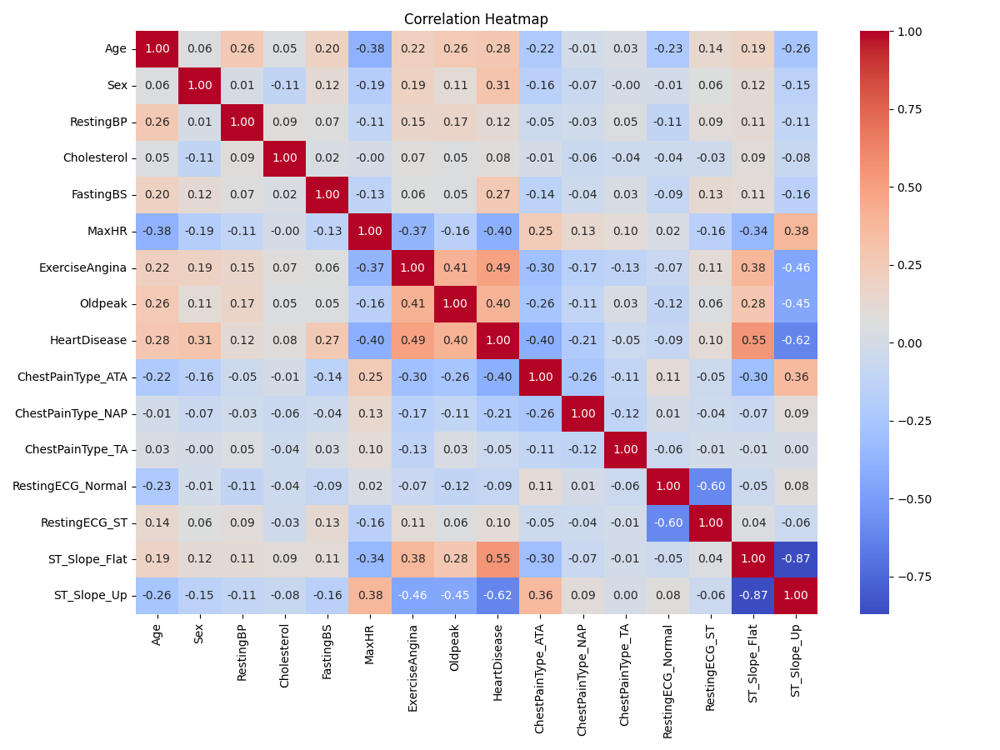
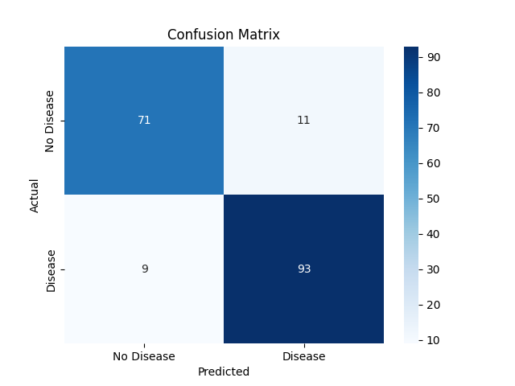

# Heart Disease Prediction using Logistic Regression

A beginner-friendly machine learning project that predicts whether a patient has heart disease from clinical data, using **Logistic Regression**.

## Dataset
- **Name:** Heart Failure Prediction Dataset (Kaggle, by fedesoriano)
- **Link:** https://www.kaggle.com/datasets/fedesoriano/heart-failure-prediction
- **Size:** 918 patients, 11 features + 1 target (`HeartDisease`: 1 = disease, 0 = no disease)
- File included in this repo: `heart.csv`

## Why Logistic Regression? (Model Selection)
- The target is **binary** (disease / no disease), which is exactly what logistic regression is built for.
- The classes are fairly balanced (508 vs 410), so accuracy and recall are both meaningful.
- The dataset is small (918 rows), where a simple model works well and is less likely to overfit.
- The coefficients are **interpretable**, which matters in healthcare.

> Model suggestion from ChatGPT: see "Screenshot 2026-11-26 031032.png"

## Project Steps
1. **Load data** and inspect it
2. **Clean data:** impossible 0 values in `Cholesterol` and `RestingBP` treated as missing and filled with the median; duplicates checked (none found)
3. **Encode categorical data:** 0/1 mapping for binary columns, one-hot encoding for the rest
4. **Correlation analysis** with a heatmap
5. **Train-test split** (80% / 20%, stratified) and feature scaling
6. **Train** a Logistic Regression model
7. **Evaluate** with accuracy, ROC-AUC, confusion matrix and classification report

## Results
| Metric | Value |
|---|---|
| Accuracy | 89.1% |
| ROC-AUC | 0.93 |
| Precision (disease) | 0.89 |
| Recall (disease) | 0.91 |

Confusion matrix (test set): 71 true negatives, 11 false positives, 9 false negatives, 93 true positives.




## How to Run
```bash
git clone https://github.com/<your-username>/heart-disease-logistic-regression.git
cd heart-disease-logistic-regression
pip install -r requirements.txt
python heart_disease_model.py
```

## Project Structure
```
heart-disease-logistic-regression/
├── heart.csv                  # dataset
├── heart_disease_model.py     # full source code
├── requirements.txt           # libraries needed
├── output.txt                 # printed results of one run
├── correlation_heatmap.png
├── confusion_matrix.png
└── README.md
```

## Tools Used
Python, pandas, NumPy, Matplotlib, Seaborn, scikit-learn

## Author
Rishabh
